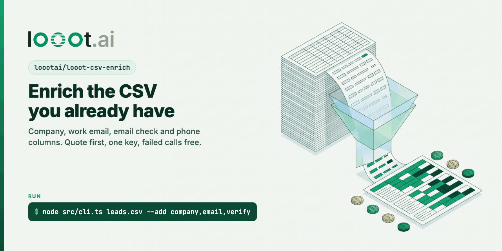

<p align="center"></p>

# looot-csv-enrich

[](LICENSE) [](https://github.com/loootai/looot-csv-enrich/releases) [](https://docs.looot.ai)

Give it the CSV you already have. It adds the columns you ask for: company details, work email, email check, phone, job title. Before it spends anything it prints a quote for the whole file. It runs only when you add `--run`, and it never goes over your budget.

It runs on [looot](https://looot.ai): one token and one prepaid balance for 2,500+ data API endpoints from 90+ providers. Each cell is one looot job run. If the first provider misses or fails, looot tries the next one for the same job, and you pay only for attempts that ran. A failed call costs $0.

No runtime dependencies. Plain `fetch`, Node 22.18 or newer (it runs the `.ts` files directly).

## Try it without spending anything

```bash
git clone https://github.com/loootai/looot-csv-enrich
cd looot-csv-enrich
node src/cli.ts examples/leads.csv --add company,email,verify,phone
```

No token needed. It reads the free public price list and prints this (real output, 2026-10-08):

```
Read 5 rows from examples/leads.csv.
Columns found: email="Email", first_name="First Name", last_name="Last Name", domain="Website", company="Company"
Quote for 5 rows (nothing spent yet):
  company  job:company.enrich               5 calls, from $0.0019/call, 21 providers, 0 rows skipped
  email    job:people.email.find            3 calls, from $0.0036/call, 17 providers, 2 rows skipped
  verify   job:people.email.verify          2 calls + up to 3 if an email is found, from $0.0014/call, 13 providers, 0 rows skipped
  phone    job:people.phone.find            4 calls + up to 1 if an email is found, from $0.0048/call, 12 providers, 0 rows skipped
  At the cheapest listed prices: $0.04. Most it can spend ($0.05 cap per call): $0.90.
  Misses and failed calls cost $0.
  Budget for this run: $1.00.

Dry run, nothing spent. Add --run to enrich.
```

## Run it for real

1. Sign up at https://looot.ai, top up (from $5), and create an agent token with the scopes `catalog.read`, `runs.read`, `runs.execute` and `usage.read`.
2. Run:

```bash
export LOOOT_TOKEN=...   # never commit this
node src/cli.ts my-leads.csv --add company,email,verify --budget 2 --run
```

It writes `my-leads.enriched.csv` after every row, so a stopped run keeps what it found. Run the same command again and it picks up from that file: filled cells are skipped, and any call it repeats uses the same idempotency key, so looot returns the first answer and does not charge again.

## Docker

The same CLI as an image, for machines without Node 22. The folder you mount at `/data` is the working directory, so file names are relative to it.

```bash
# quote, no token
docker run --rm -v "$PWD:/data" loootai/looot-csv-enrich leads.csv --add company,email,verify

# paid run: the token is passed from your shell, never baked into the image
docker run --rm -e LOOOT_TOKEN -v "$PWD:/data" loootai/looot-csv-enrich leads.csv --add company,email,verify --budget 2 --run
```

The image is `node:22-alpine` pinned by digest, runs as the unprivileged `node` user (uid 1000) and has no dependencies beyond Node. On Linux, if your folder belongs to another uid, add `--user "$(id -u):$(id -g)"`. To build it yourself: `docker build -t looot-csv-enrich .`

Publishing: `.github/workflows/docker-publish.yml` builds linux/amd64 and linux/arm64 and pushes to Docker Hub when a `v*` tag is pushed. It needs the repository secrets `DOCKERHUB_USERNAME` and `DOCKERHUB_TOKEN`. The image name above assumes the Docker Hub namespace `loootai`. Overview text for the Docker Hub page is in [docs/DOCKERHUB.md](docs/DOCKERHUB.md).

## Columns you can add

| `--add` | looot job | Needs in the row | Adds |
| --- | --- | --- | --- |
| `company` | `company.enrich` | domain, website, a work email, or a company name | `company_name`, `company_industry`, `company_employees`, `company_country`, `company_linkedin` |
| `email` | `people.email.find` | first and last name (or a full name), and a domain or company. Rows that already have an email are skipped | `work_email` |
| `verify` | `people.email.verify` | an email, or the `work_email` found in the same run | `email_status`: valid, invalid, catch_all, risky or unknown |
| `phone` | `people.phone.find` | a LinkedIn URL, an email, or name plus domain | `phone` |
| `person` | `people.enrich.by-email` | an email | `person_title`, `person_linkedin`, `person_location` |

Every run also adds `looot_cost_usd` (what that row cost) and `looot_notes` (misses, failures, budget stops).

Headers are matched loosely: `First Name`, `first_name` and `firstname` all work, and so do `Website`, `Company Website` and `Domain`. A free-mail address (gmail.com and the like) is never used as a company domain. Force a column with `--map domain="Company URL"`.

## Options

| Flag | Meaning | Default |
| --- | --- | --- |
| `--add` | Comma list of the columns above | required |
| `--run` | Spend money. Without it you only get the quote | off |
| `--out` | Output CSV | `<file>.enriched.csv` |
| `--budget` | Total USD for this run. A call starts only if its cap still fits | 1.00 |
| `--max-per-call` | Cap for one cell, across every provider tried | 0.05 |
| `--attempts` | Providers to try per cell | 3 |
| `--concurrency` | Rows in flight at once | 4 |
| `--map field=Header` | Force a column: email, first_name, last_name, name, domain, company, linkedin_url | |

## How a cell runs

```
for each row (4 at a time):
  for each chosen column, in the order company, email, verify, phone, person:
    skip if the output cell is already filled, or the row lacks the inputs
    skip if spent + calls in flight + this call's cap would pass --budget
    POST /v1/runs?wait=30 {endpointId: "job:<job>", input, idempotencyKey: sha256(job, input, cap),
                           fallback: {maxAttempts, maxCostUsd: --max-per-call}}
    poll GET /v1/runs/{id} until completed, failed, blocked or stopped
    write the values, add the cost, note a miss or failure
  save the CSV
stop everything on 402 (balance) or 401/403 (token) and print why
```

## Why this is different

The usual way to enrich a lead CSV yourself is to stitch several services together: one account for an email finder, one or two for verification, one for company data, a scraping or search API, and often an LLM writing glue code per run. Each has its own key, its own credit system and its own free-tier limit, and when one runs out you switch to the next by hand. You learn what a run cost after it ran.

This tool takes a different route:

- One key. Every column is a looot job, and each job has between 10 and 21 providers behind it today.
- A quote before the run, from looot's public price list, plus a hard total budget and a per-cell cap.
- Fallback inside one call: when a provider misses, looot tries the next one, and only attempts that ran are charged. A failed call is $0.
- No generated code. The same input always takes the same path, and the idempotency key means a rerun never pays twice.
- 26 tests with a fake API, no network.

What it does not do: free tiers are $0 and looot is not, so if you only need a few hundred lookups a month and do not mind juggling accounts, free tiers are cheaper. Calls go through looot's servers, so this is not a fully local setup. There is no UI; for a grid in the browser see [looot-tables](https://github.com/loootai/looot-tables).

## Tests

```bash
npm test          # node --test, 26 tests, fake API, no network, no money
npm install && npm run typecheck
npm run scan      # leak scan, also runs as a pre-commit hook: git config core.hooksPath .githooks
```

## Related

- [looot-lead-gen-agent](https://github.com/loootai/looot-lead-gen-agent): start from company domains and find the people first.
- [looot-tables](https://github.com/loootai/looot-tables): the same idea as a Next.js grid with Supabase.
- [awesome-gtm](https://github.com/loootai/awesome-gtm): open-source GTM tools.
- looot MCP server for agents: `claude mcp add --transport http looot https://api.looot.ai/mcp`

## License

MIT, copyright looot.
